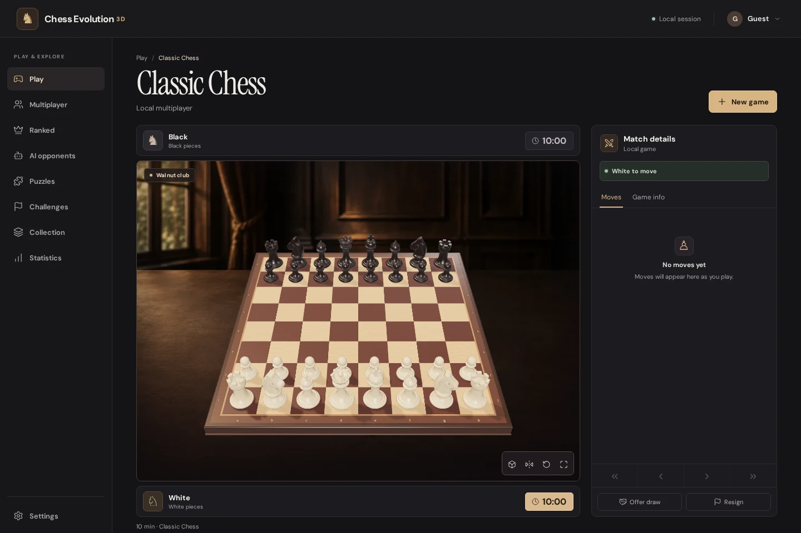

# Chess Evolution 3D

A browser chess game with a real-time 3D board, a keyboard-accessible 2D view, a Stockfish opponent and a Node.js multiplayer server.



[Orbital station](docs/screenshots/orbital.webp) · [Close-up camera](docs/screenshots/close-up.webp) · [Piece inspection](docs/screenshots/pieces.webp) · [Mobile](docs/screenshots/mobile.webp) · [Menus](docs/screenshots/menus.webp) · [Stockfish analysis](docs/screenshots/analysis.webp)

## Run locally

Use Node.js 22.12+ or 24 LTS.

```sh
npm ci
npm run dev
```

Open http://localhost:5173. Vite serves the client and forwards WebSocket connections to the game server on port 8787.

Select **New game** for local rules and time controls. **AI opponents** offers 30 Stockfish settings with adjustable search time. **Multiplayer** creates an invitation, joins a room by code, or starts casual matchmaking. **Ranked** matches players with the same time control and shows the seasonal ladder. The camera control below the board switches between 3D and 2D without resetting play.

## Deploy to Cloudflare Workers

The repository includes the `cool-chess` Worker configuration. The Worker serves the Vite build and routes `/socket` to a SQLite-backed Durable Object for multiplayer rooms, matchmaking, timers, and ranked ratings.

For a Git-connected Worker, configure these build settings in Cloudflare:

| Setting | Value |
| --- | --- |
| Production branch | `main` |
| Root directory | `/` |
| Build command | `npm run build` |
| Deploy command | `npx wrangler deploy` |

The Worker name in `wrangler.jsonc` matches the existing `cool-chess` service. For a manual deploy, authenticate Wrangler, then run `npm ci` and `npm run deploy`. Use `npm run dev:cloudflare` for a local Worker preview. With that preview running, run `CHESS_TEST_WS_URL=ws://127.0.0.1:8787/socket node --test tests/socket.test.js` to exercise the Worker WebSocket flow.

Cloudflare stores rooms and ranked ratings in Durable Object storage, so active matches can resume after the object restarts. One Durable Object coordinates the current lobby and leaderboard.

## Production on Node.js

```sh
npm ci
npm run build
npm start
```

The same Node process serves `dist/` and upgrades `/socket` to WebSockets. The default port is 8787 and can be changed with `PORT`. Put it behind an HTTPS reverse proxy that forwards WebSocket upgrades and preserves the incoming Host header. Use the public HTTPS origin for invite links. A public deployment needs a server that runs Node continuously.

Keep the default `data/ratings.json` on a persistent volume, or set `CHESS_RATINGS_PATH` to another persistent file. Run one server instance per data file. Active rooms and queues are held in memory. Player seats can reconnect while that process is running. Restarting it ends active rooms, but preserves ranked history. Ranked profiles use a browser-held token and personal preferences and presets use local browser storage.

## Graphics and modes

- Twenty distinct illustrated environments with independent board palettes, scene lighting, and weather in selected scenes. The board and pieces use realtime geometry, shadows, filmic tone mapping, and physically based materials.
- Fifteen procedural piece collections share recognizable chess silhouettes with different turned profiles and faceting. Choose white and black finishes independently, inspect each piece in an orbiting close-up viewer, and save presets. Ultra and Photorealistic presets load higher-resolution walnut textures and raise shadow resolution.
- Standard chess, Chess960, King of the Hill, Three-Check, Crazyhouse, and a local Fog of War ruleset. Fog keeps standard legal movement and shows the side to move its own pieces and legal destinations. Move history is revealed at the end. Variant games are local, and online matches use standard chess.
- Stockfish runs in a Web Worker. Strength settings are relative and are not calibrated Elo measurements. The browser uses the Lite single-threaded build.
- Puzzles, a rotating daily selection, progressive Survival and themed Boss Battles. Finished standard games support move replay, PGN export, and Stockfish analysis. Sandbox accepts a FEN or the final position of an imported PGN.
- Approximate analysis accuracy is the mean of `100 × exp(−centipawn_loss / 235)` for evaluated moves of each side. Engine scores are short-search estimates and can vary with hardware. Mate evaluations are capped to a fixed comparison score when calculating grades.
- Local XP tracks eligible completed matches, AI wins, and first-time puzzle solves. Profile avatars unlock at player levels 2 and 4.
- Elo is computed on the server for bullet, blitz, and rapid, with larger updates in early matches, rank bands, quarterly seasons, and persisted results.

## Verification

```sh
npm test
npx playwright install chromium
npm run test:browser
```

Automated coverage includes special moves and draw rules, local variants, timed moves, server move validation, reconnecting seats, ranked result persistence, private rooms in two independent browser contexts, all 30 engine settings, analysis, and a mobile-width match. The timeout rules cover common insufficient-mating-material cases. Exhaustive proof of a possible mating sequence in unusual positions is outside this implementation.

## Visual references and assets

The supplied 18 concept images and the linked [Chess Infinity](https://www.dekudeals.com/items/chess-infinity), [Teckell Stratego](https://designitaly.com/products/chess-game-board-stratego-lorenzo-digiovanni-teckell), [Cyberpunk Chess Board](https://sketchfab.com/3d-models/cyberpunk-chess-board-c389e219c1514a46b7aca3a018afc5f2), [Chess VR](https://store.steampowered.com/app/2054100/), and [Marmo Storage Chess Set](https://www.chessworld.com.au/products/marmo-storage-chess-set) were used for visual direction. The meshes and texture patterns are procedural and the environment artwork is original generated imagery.

Stockfish ([upstream source](https://github.com/nmrugg/stockfish.js), GPL-3.0) and chessops ([upstream source](https://github.com/niklasf/chessops), GPL-3.0) retain their upstream terms. The production build copies the Stockfish license alongside its WebAssembly worker.
