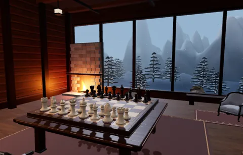

# Chess Evolution 3D

A browser chess game with a real-time 3D board, a keyboard-accessible 2D view, a Stockfish opponent and a Node.js multiplayer server.



[Play on Cloudflare](https://cool-chess.52560.workers.dev/) · [Immersive worlds](docs/immersive-worlds.md) · [Gameplay visibility and multiplayer](docs/gameplay-clarity.md) · [Stockfish review](docs/stockfish-review.md) · [Christmas collection](docs/christmas-side-reel.md) · [Side Reel phone and arcade](docs/phone-arcade.md) · [Entertainment rebuild](docs/entertainment-rebuild.md)

## Run locally

Use Node.js 22.12+ or 24 LTS.

```sh
npm ci
npm run dev
```

Open http://localhost:5173. Vite serves the client and forwards WebSocket connections to the game server on port 8787.

Select **New game** for local rules and time controls. **AI opponents** offers 100 rated presets, manual Elo, and maximum-strength Stockfish Lite. **Multiplayer** creates an invitation, joins a room by code, or starts casual matchmaking. **Ranked** matches players with the same time control and shows the seasonal ladder. The camera control below the board switches between 3D and 2D without resetting play.

## Deploy to Cloudflare Workers

The repository includes the `cool-chess` Worker configuration. The Worker serves the Vite build and routes `/socket` to a SQLite-backed Durable Object for multiplayer rooms, matchmaking, timers, and ranked ratings.

For a Git-connected Worker, configure these build settings in Cloudflare:

| Setting | Value |
| --- | --- |
| Production branch | `main` |
| Root directory | `/` |
| Build command | `npm run build` |
| Deploy command | `npx wrangler deploy` |

The Worker name in `wrangler.jsonc` matches the existing `cool-chess` service. For a manual deploy, authenticate Wrangler, then run `npm ci` and `npm run deploy`. Use `npm run dev:cloudflare` for a local Worker preview. With that preview running, run `CHESS_TEST_WS_URL=ws://127.0.0.1:8787/socket node --test tests/socket.test.js` to exercise the Worker WebSocket flow.

Cloudflare stores rooms and ranked ratings in Durable Object storage, so active matches can resume after the object restarts. One Durable Object coordinates the current lobby and leaderboard.

## Production on Node.js

```sh
npm ci
npm run build
npm start
```

The same Node process serves `dist/` and upgrades `/socket` to WebSockets. The default port is 8787 and can be changed with `PORT`. Put it behind an HTTPS reverse proxy that forwards WebSocket upgrades and preserves the incoming Host header. Use the public HTTPS origin for invite links. A public deployment needs a server that runs Node continuously.

Keep the default `data/ratings.json` on a persistent volume, or set `CHESS_RATINGS_PATH` to another persistent file. Run one server instance per data file. Active rooms and queues are held in memory. Player seats can reconnect while that process is running. Restarting it ends active rooms, but preserves ranked history. Ranked profiles use a browser-held token and personal preferences and presets use local browser storage.

## Showroom and gameplay update

The home screen previews the current setup with a slowly orbiting camera. Open **Collection** to browse sets, boards, locations, tables, lighting, cameras, and move and capture effects. White and black piece editors preview a single model and let you apply field changes to one piece type, one side, or both sides. Save a preset to keep the full appearance, including separate white and black piece settings.

Right-drag to orbit, middle-drag to pan, and scroll to zoom. In Seated view, right-drag to look from the player's chair and left-click to play. In Free roam, use **WASD** or the touchscreen arrows to walk, and drag to look. Press **C** to cycle cameras and **R** to reset. Double-click a piece in a match to focus on it. Open **Photography mode** to adjust field of view, exposure, background blur, focus distance and lighting, pause the environment, and save a PNG.

**Ranked AI** starts new players at 0 Elo and uses nearby bot targets, a separate browser-local rating history, and 22 fictional ranks. From the match panel, **Game info** supports saving a casual game, requesting a hint in casual AI, or undoing the last casual AI turn. **Challenges** includes interactive lessons. Custom casual clocks support increments. [Ranked AI rules and calibration](docs/ranked-ai.md)

## Graphics and modes

- Twenty-nine locations use 3D architecture and scenery, site-specific furniture and motion, and local reflection probes at compatible quality settings. The room and board are independently selectable. Existing location preferences are mapped to the closest available 3D location.
- Fifty-three piece editions include twenty new animated models. Their geometry, moving components, surface shaders and move and capture effects can be previewed in the showroom. The board library includes 42 finishes, 22 with animated shaders. Higher quality settings raise texture and shadow resolution. **Low** and **2D** are available for less powerful devices.
- Standard chess, Chess960, King of the Hill, Three-Check, Crazyhouse, and a local Fog of War ruleset. Fog keeps standard legal movement and shows the side to move its own pieces and legal destinations. Move history is revealed at the end. Variant games are local, and online matches use standard chess.
- Ranked and casual AI use a dedicated Web Worker for weaker bots and progressively larger Stockfish Lite searches at higher ratings. Game review continues to use its own Stockfish Lite worker. Elo labels are approximate difficulty targets.
- Puzzles, a rotating daily selection, progressive Survival and themed Boss Battles. Finished standard games support move replay, PGN export, and Stockfish analysis. Sandbox accepts a FEN or the final position of an imported PGN.
- Stockfish review includes engine candidate lines, a clickable evaluation graph, move classifications, per-side accuracy and an opening explorer. See the [review controls and scoring method](docs/stockfish-review.md).
- Local XP tracks eligible completed matches, AI wins, and first-time puzzle solves. Profile avatars unlock at player levels 2 and 4.
- Elo is computed on the server for bullet, blitz, and rapid, with larger updates in early matches, rank bands, quarterly seasons, and persisted results.

## Verification

```sh
npm test
npx playwright install chromium
npm run test:browser
```

Automated coverage includes standard perft through depth five and Kiwipete through depth three, special moves and draw rules, local variants, timed moves, server move validation, reconnecting seats, ranked result persistence, private rooms in two independent browser contexts, all 100 rated bot presets and the unrestricted opponent, analysis, a mobile-width match, animated material rendering, and a location switch during a match followed by a PNG export. The timeout rules cover common insufficient-mating-material cases. Exhaustive proof of a possible mating sequence in unusual positions is outside this implementation.

## Internal AI benchmark

Run `node scripts/benchmark-ai.js 8` for the color-swapped tournament and position probes. [Measured results](docs/ranked-ai.md)

## Visual references and assets

Visual direction comes from the supplied reference packs. The game uses original procedural geometry and shaders, with sourced furniture, rocks, plants, wood and Earth surface data. See the asset sources and licenses in the [immersive world notes](docs/immersive-worlds.md#assets).

Stockfish ([upstream source](https://github.com/nmrugg/stockfish.js), GPL-3.0) and chessops ([upstream source](https://github.com/niklasf/chessops), GPL-3.0) retain their upstream terms. The production build copies the Stockfish license alongside its WebAssembly worker.
